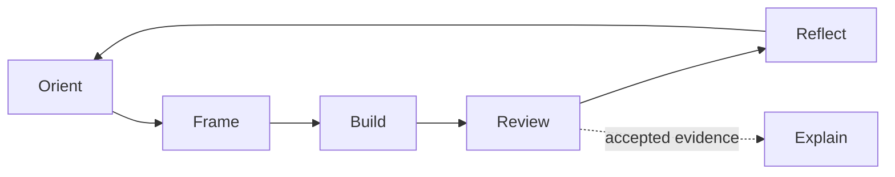
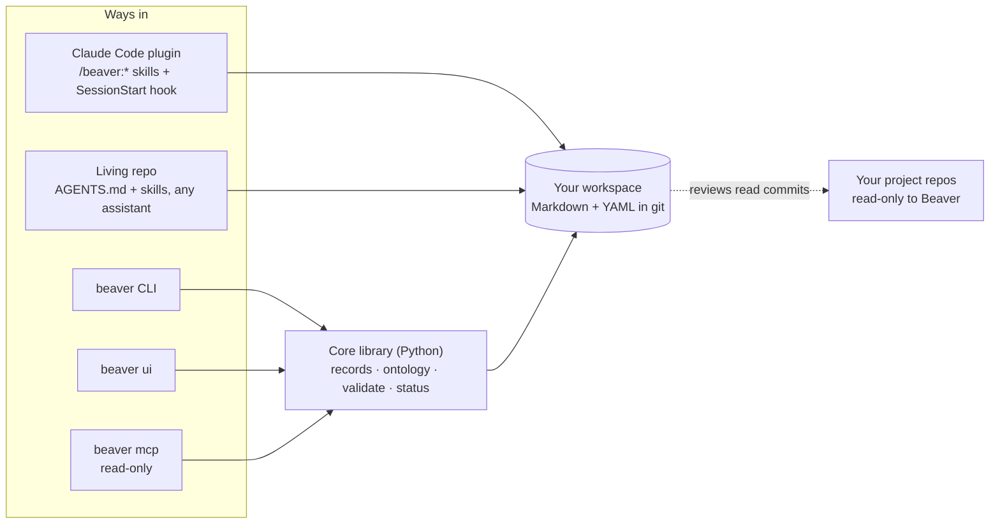
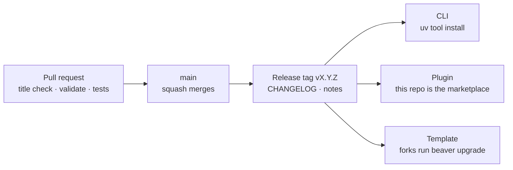

# Beaver

**An open apprenticeship harness for AI-focused forward-deployed engineering.** Beaver is one repository that holds what you build and what you learn, across data, ML, AI, product and platform work. It grounds your coding assistant in your goals, keeps notes and questions in one place so knowledge compounds, and turns good work into honest evidence. You do the work. Beaver is the mentor behind the screen, from the first idea to the final review.

> **Status: early build, not usable yet.** M0 · Foundations runs until the Nov 8, 2026 gate. Beaver is built in the open and dogfooded from day one: see the [milestones](https://github.com/prabakaranc98/project-beaver/milestones), [`docs/build-plan.md`](docs/build-plan.md) and [`docs/design.md`](docs/design.md).

## Try it now

From a clone of this repo, with [uv](https://docs.astral.sh/uv/) installed:

```bash
uvx --from . beaver validate core/examples                 # the sample workspace: all records check out
uvx --from . beaver validate tests/fixtures/broken-links   # three planted problems, in plain words
python bench/bench.py shell --workspace core/examples --fork   # Claude Code + Beaver in a sandbox, a week into the sample
```

The last line needs `OPENROUTER_API_KEY` in `.env`; see `CONTRIBUTING.md`.

## The loop

Every piece of work runs through one loop. Review is the step that turns work into evidence, and Explain can only use what Review accepted.



Your assistant works in an assistance mode you choose: Socratic, Hint, Example, Pair or Delegate. Delegated work is tagged, and it stays at level 1 (Produced) until you can explain it.

## Ways in

All paths share one workspace format, so you can switch paths without losing anything.

| Path | Best for | Start with |
| --- | --- | --- |
| **Claude Code plugin** | Anyone already in Claude Code | `/plugin marketplace add prabakaranc98/project-beaver`, then `/plugin install beaver@beaver`, then `/beaver:onboard` |
| **Living repo (your fork)** | Claude Code in the VS Code terminal, other skills-compatible assistants (Codex, Cursor, Gemini CLI and others), or no assistant at all | "Use this template", or `beaver init`, then open the folder and start your assistant |
| **`beaver` CLI** | State, sprints and checks from the terminal, with no model and no tokens | `uv tool install project-beaver` once it is published; the command is `beaver` |
| **`beaver ui`** (M4) | Seeing it all at once | `beaver ui`, served on localhost with no account |

Your workspace is the source of truth: plain Markdown and YAML in git. Everything else is a thin client over it.

## How it fits together



Beaver never runs an agent loop of its own. Your coding assistant stays the agent. Beaver owns the method, the records, the checks and the learning-first contract.

| Subsystem | What it is | Where it lives | When |
| --- | --- | --- | --- |
| Workspace template | Folders with one owner each: method (`core/`), your records, and `generated/` for assistant output | repo root | M0 |
| Ontology | One object per file, YAML frontmatter, `type.slug` IDs; capabilities, concepts, inquiries, evidence, briefs, sprints | `core/ontology/` | M0 |
| Templates | Brief, evidence, reflection, concept, inquiry, now | `core/templates/` | M0 |
| Validator | Schemas, ID resolution, wikilinks; CI runs it on every PR | `tools/validate` | M0 |
| Progress check | Deterministic, no model: inbox, aging questions, unreviewed commits, reflection gap | `tools/status` → `generated/status.md` | M1 |
| Skills | Bounded workflows with fixed output folders: `onboard`, `frame-challenge`, `review-evidence` first, then `capture`, `orient`, `reflect` | `.agents/skills/` | M1–M2 |
| Claude Code plugin | The same skills as `/beaver:*`, plus a SessionStart hook | `.claude-plugin/` | M2 |
| CLI | `beaver`, `capture`, `sprint`, `validate`, then the full lifecycle | `beaver` package | M2, M3 |
| Local UI | A view over the files, never a second source of truth | `beaver ui` | M4 |
| Companion | Optional weekly digest on your own key; an observer, not an actor | `companion/` | after the MVP |

## What it looks like

**In the terminal.** `beaver` runs the progress check and points to one next action.

```text
$ beaver
Progress check · Tue Nov 3, 09:12
  inbox        6 captures not yet processed
  inquiries    3 open for more than 2 weeks
  review       project.crm-sync: 14 commits since the last review
  reflection   last one 9 days ago
  balance      all recent work on the AI track; nothing on platform this month

Next: explain the retry decision in your own words (DECISIONS.md #4) · mode: Hint
```

**In the UI** (M4, sketch). It is calm and document-like. Progress shows as evidence and open questions, never points.

```text
Beaver   Now   Sprint   Projects   Concepts   Inquiries   Evidence
──────────────────────────────────────────────────────────────────
NEXT ACTION                                             mode: Hint
Explain the retry decision in your own words     → DECISIONS.md #4

WAITING                              SPRINT s03 · crm-sync-retries
6 captures in the inbox              11.5 of 20 h · ends Friday
3 inquiries open > 2 weeks           1 session with no artifact
14 commits since the last review
Last reflection 9 days ago           MENTOR NOTE           dismiss
                                     Retries came up in crm-sync
                                     and search-api. One concept
                                     note?
```

The evidence ladder is the main visual. Each rung links to the files that prove it.

```text
capability.api-integration
  5 Delivered    ·  someone else used it
  4 Maintained   ·  fixed or extended weeks later
  3 Varied       ·  solved a transfer variation
  2 Explained    ■  retry-flow walkthrough        evidence/crm-sync-retries.md
  1 Produced     ■  3 commits, 2 tests            crm-sync@a1b2c3d
  0 Claimed      ■  resume line
```

## Design language

The design doc sets the stance: calm, document-like, a small token set, five semantic colors in light and dark, and no streaks, badges or confetti. The specifics below are *proposed* and get settled in M4 (#51).

- **Type** *(proposed).* One open-licensed superfamily, IBM Plex: Serif for reading records, Sans for interface chrome, Mono for IDs, commands and code. The fonts are bundled with the UI, so it works offline; the terminal keeps your own font.
- **Color** *(proposed).* Five semantic roles, each meaning one thing everywhere: **evidence** (reviewed and accepted), **inquiry** (an open question), **draft** (generated, not authoritative), **attention** (waiting or aging), **boundary** (a limit or a never-automate zone). The CLI maps the same roles to terminal colors.
- **Writing.** Plain words, short sentences, specifics over adjectives. A claim links to its evidence. Concepts climb a simplification ladder: *Plain words*, then *Practitioner*, then *Formal*, then *Still fuzzy*. Every agent-written file says which agent, model and assistance mode wrote it.
- **Illustration** *(proposed).* Diagrams are text (Mermaid in Markdown), so they render on GitHub, in Obsidian and in VS Code, and they diff in git. One visual grammar: boxes are records, cylinders are stores, dashed lines are reads or drafts, arrows are the flow of work. Each diagram answers one question, and none is decoration.

## Background modes

Nothing runs unless you start it. "Background Beaver" is a deterministic watcher plus an optional scheduled companion. It is never an autonomous agent.

| Level | How you turn it on | What it does | Uses a model? |
| --- | --- | --- | --- |
| Off | Default | Nothing | No |
| Passive | Git hooks, or `beaver` at session start | Progress check at each session start and commit | No |
| Watching | `beaver watch` in the foreground, or as a user service | Re-checks on file changes, keeps the sprint clock, queues nudges | No |
| Companion | A schedule you set: local cron, a GitHub Action on a private repo, or your assistant app *(the CLI switch is proposed)* | A weekly digest in `generated/digests/`: what you did, what's connecting, one question, one next action | Yes: your key, your budget |
| Personal agents | Add `beaver mcp` to an MCP-capable agent | Reads now, status and open inquiries; proposes nudges with no write access | Theirs |

**Guards** that every background part follows:
- It writes only to `generated/` and never touches your records or your project repos.
- At most 3 nudges a week by default, each linking to your own file and ending with one question.
- It never automates the parts that build judgment: framing the problem, the core design decision, the explanation, the reflection, or any claim of capability.

## How Beaver reaches you

One repository and one version tag feed every channel. Items marked *proposed* are not in the design doc yet.



- **Every PR** runs CI: a Conventional Commits title check, the validator and the tests. `main` is protected, and merges are squashed.
- **Every release** gets a tag, a `CHANGELOG.md` entry and release notes with an upgrade section. A schema change bumps `schema_version` and ships with a migration.
- **Nothing ships on a date.** Release acceptance ([#54](https://github.com/prabakaranc98/project-beaver/issues/54), *proposed*) checks every feature a release claims in four ways: a test, a fixture, an agent run that uses Beaver as a learner would, and a hand run. A separate reviewer run reads only the notes and the evidence, and it flags any claim the evidence does not back. The notes list only checked claims.
- **The CLI** installs from a tag with `uv tool install git+https://github.com/prabakaranc98/project-beaver@vX.Y.Z` *(proposed)*, and from PyPI as `project-beaver` once published.
- **The plugin** installs from this repo's own marketplace. A release workflow *(proposed)* checks that the versions in `pyproject.toml`, `plugin.json` and `marketplace.json` agree.
- **Your fork** upgrades with `beaver upgrade`. It pulls `core/` and the skills from a tag, runs migrations and shows the changelog, and it never touches your own folders. *Proposed:*
  - The template's `.claude/settings.json` enables the Beaver plugin, so opening your fork in Claude Code and trusting the folder is the whole install.
  - An optional workflow in your fork opens an upgrade PR when a new tag lands.
  - A dev container makes the fork open ready to use in Codespaces or VS Code.

## Principles

1. **Craft and conviction.** Understand the problem, choose deliberately, and stand behind the result with reasons.
2. **Evidence over activity.** An artifact proves something only when it is tied to a claim and checked.
3. **Agency stays with the learner.** Assistance is graduated, and the learner decides.
4. **Knowledge compounds in one place.** Notes, questions and projects live together and link to each other.
5. **Portable and plain.** Markdown and YAML in git, usable with any assistant or none.
6. **Small core, optional accessories.** Nothing in the core depends on an accessory.

How every part of Beaver serves these, and how its agent behaves moment by moment: [`docs/the-beaver-way.md`](docs/the-beaver-way.md).

## Contributing

Read [`CONTRIBUTING.md`](CONTRIBUTING.md). Every change starts from an issue and goes through a PR with green CI. Friction found while dogfooding becomes a *Dogfood friction* issue the same day.

## License

Beaver itself, meaning its code, method, skills and templates, is [MIT](LICENSE). What you write in your own workspace is yours. The license does not cover your notes, evidence, reflections or projects, and they carry no license unless you add one.
