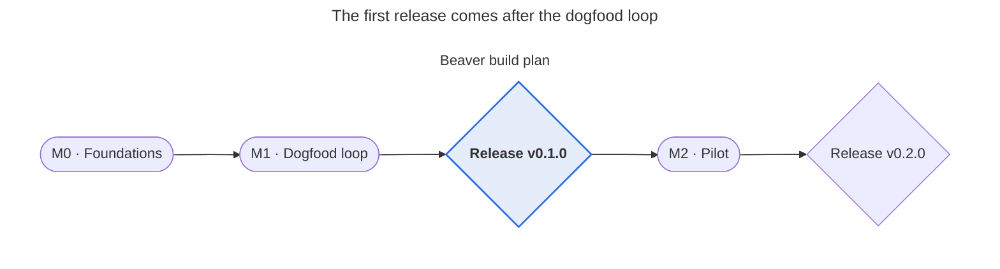

# Build plan

Beaver is built in the open with GitHub issues, milestones, PRs and releases, and dogfooded from day one. Milestones close on their exit criteria, not on dates (decided 2026-11-01).

## Dogfood protocol

Pracha is learner zero. Beaver is developed inside the same loop it teaches, and every moment of friction becomes an issue. The project Beaver mentors during Stage 0 is real FDE-door work, so its evidence feeds the job search too.

| Cadence | What Pracha does | What gets recorded |
| --- | --- | --- |
| Every session | Run the progress check, work in a sprint, log the session | Sprint log line, build time |
| Every friction | Anything confusing, slow, noisy or missing becomes an issue labeled `dogfood-friction` within the day | One issue per friction, one line each |
| Weekly (Sunday) | Run `review-evidence` on the week's commits; write a reflection; triage friction issues | Review, reflection, triaged backlog |
| End of each milestone | Measure the build ratio and look at value per token; decide go, adjust or kill | Gate note in `DECISIONS.md` |

**Two repos from day one.** `beaver` is the method plus tools, developed with issues and PRs. `beaver-workspace-pracha` is Pracha's own fork, where the learning happens. Keeping them apart tests the fork-and-upgrade model for real.

## Milestones

Three milestones and two releases. Each milestone closes only when its exit criteria are met, never just because the date has passed.

| Milestone | Goal | Exit criteria | Release |
| --- | --- | --- | --- |
| M0 · Foundations | The workspace exists, validates, and CI is green | Schema + templates merged; `validate` passes on the example workspace in CI; CHARTER.md and AGENTS.md reviewed | — |
| M1 · Dogfood loop | One real project goes through a full loop with Beaver | Three v1 skills used for real; progress check runs at session start; 5 knowledge pages; one review + one reflection; before/after briefs sent for blind review | v0.1.0 |
| M2 · Pilot | Someone other than the author uses it | Claude Code plugin installs cleanly; one pilot learner onboarded and finishes a loop; debrief held; go/kill decision recorded | v0.2.0 |

v0.1.0 is the first gate that matters: it ships only if the dogfood loop shows a better brief. M3 · Rich CLI and M4 · Local UI run in parallel and are not gated on M2 (decided 2026-11-01).

## Issue backlog

Twenty-three issues seed the repo, and the GitHub kit creates them in one run. On GitHub they are #22–#44, in this order. Sizes are S (under 2 hours), M (half a day) and L (a day or more).

| # | Issue | Milestone | Labels | Size | Done when |
| --- | --- | --- | --- | --- | --- |
| [#22](https://github.com/prabakaranc98/project-beaver/issues/22) | Scaffold the repo: folders, README, LICENSE | M0 | chore | S | Tree matches the design doc; license chosen |
| [#23](https://github.com/prabakaranc98/project-beaver/issues/23) | Write CHARTER.md | M0 | docs, core | S | One page; passes the illusion test |
| [#24](https://github.com/prabakaranc98/project-beaver/issues/24) | Write AGENTS.md and a CLAUDE.md that imports it | M0 | docs, adapter | S | Under 80 lines; Claude Code shows it at session start |
| [#25](https://github.com/prabakaranc98/project-beaver/issues/25) | Define record schemas (capability, concept, inquiry, evidence, brief, sprint, registry) | M0 | feat, core | M | Schemas in `core/ontology/`; example records validate |
| [#26](https://github.com/prabakaranc98/project-beaver/issues/26) | Write templates: brief, evidence, reflection, concept, inquiry, now | M0 | docs, core | S | Each template validates against its schema when filled |
| [#27](https://github.com/prabakaranc98/project-beaver/issues/27) | Build `tools/validate`: schema, ID resolution, wikilinks | M0 | feat, core | M | Fails on a broken link or a missing claim; passes on the example |
| [#28](https://github.com/prabakaranc98/project-beaver/issues/28) | Add CI: validate + unit tests on every PR | M0 | chore, test | S | A red PR blocks merge |
| [#29](https://github.com/prabakaranc98/project-beaver/issues/29) | Build an example workspace as test fixtures | M0 | test | M | Used by unit and snapshot tests |
| [#30](https://github.com/prabakaranc98/project-beaver/issues/30) | Build `tools/status` v0: inbox, aging inquiries, unreviewed commits, reflection gap | M1 | feat, core | M | Snapshot test matches expected output on the fixture |
| [#31](https://github.com/prabakaranc98/project-beaver/issues/31) | Skill: `onboard` | M1 | feat, skills | M | Seven questions; resume lines land as level-0 claims |
| [#32](https://github.com/prabakaranc98/project-beaver/issues/32) | Skill: `frame-challenge` | M1 | feat, skills | M | Brief has non-goals and a testable done-when |
| [#33](https://github.com/prabakaranc98/project-beaver/issues/33) | Skill: `review-evidence` | M1 | feat, skills | M | Every observation has a file or commit reference; one question; at most two actions |
| [#34](https://github.com/prabakaranc98/project-beaver/issues/34) | Skill eval checklist and scenarios for the three skills | M1 | test, skills | M | Each skill passes its boundary checks on three scenarios |
| [#35](https://github.com/prabakaranc98/project-beaver/issues/35) | Write five seed knowledge pages | M1 | docs, knowledge | L | One page per pillar plus two practice areas, in the page format |
| [#36](https://github.com/prabakaranc98/project-beaver/issues/36) | Dogfood: register one real project and run the full loop | M1 | dogfood | L | Brief → sprint → review → reflection, all in the workspace |
| [#37](https://github.com/prabakaranc98/project-beaver/issues/37) | Blind brief review: before and after | M1 | dogfood | S | A reviewer scores both briefs without knowing which is which |
| [#38](https://github.com/prabakaranc98/project-beaver/issues/38) | Release v0.1.0 | M1 | release | S | Tag, changelog, release notes |
| [#39](https://github.com/prabakaranc98/project-beaver/issues/39) | Package as a Claude Code plugin with a SessionStart hook | M2 | feat, plugin | M | Installs from the repo's marketplace on a clean machine |
| [#40](https://github.com/prabakaranc98/project-beaver/issues/40) | Skills: `capture`, `orient`, `reflect` | M2 | feat, skills | M | Each passes its eval checklist |
| [#41](https://github.com/prabakaranc98/project-beaver/issues/41) | Thin `beaver` CLI: `beaver`, `capture`, `sprint`, `validate` | M2 | feat, cli | M | Works offline; zero tokens used |
| [#42](https://github.com/prabakaranc98/project-beaver/issues/42) | Onboard one pilot learner, with weekly check-ins | M2 | dogfood | M | Pilot finishes onboarding and starts a sprint |
| [#43](https://github.com/prabakaranc98/project-beaver/issues/43) | Pilot debrief and go/kill decision | M2 | dogfood | S | Decision and reasons written in DECISIONS.md |
| [#44](https://github.com/prabakaranc98/project-beaver/issues/44) | Release v0.2.0 | M2 | release | S | Tag, changelog, upgrade notes |

Issues labeled `dogfood-friction` are added continuously and triaged every Sunday.

## Branches, pull requests and reviews

Every change goes through a PR, including the author's own. The PR is also practice in the craft Beaver teaches: explain the decision, show the evidence, name the limits.

- **Branches:** `main` is protected. Work happens on `feat/<issue>-<slug>`, `docs/…`, `test/…` or `chore/…`.
- **Commits:** Conventional Commits (`feat:`, `fix:`, `docs:`, `test:`, `chore:`), so the changelog can be generated.
- **One issue per PR,** linked with `Closes #n`, and assigned to the issue's milestone.
- **The PR template asks five things:** which principle this serves; does it pass the illusion test; what was tested and how; what docs changed; what it costs in tokens, if anything.
- **Merge rule:** CI green, the template filled in, and a self-review checklist ticked. Once a pilot or contributor joins, one more reviewer is required.
- **Squash merge,** so `main` reads like the changelog.

## Testing strategy

Beaver has four layers of tests, from cheap and automatic to slow and human. The deterministic core is fully tested in CI. Skills are judged by checklists and scenarios, because their output varies from run to run.

| Layer | What it tests | How | When it runs |
| --- | --- | --- | --- |
| Unit | Parsing, schemas, ID resolution, status math, WIP limits | pytest | Every PR, in CI |
| Fixture snapshots | `validate` and `status` on example workspaces with known problems | Golden output files; a diff fails the test | Every PR, in CI |
| Skill evals | Each skill against three scenarios: does it write only to `generated/`, cite files, end with one action, stay under its token cap? | A checklist run by hand in M1; headless runs in a scheduled job later | Before each release |
| Dogfood acceptance | Does Beaver actually help? | Build ratio, blind brief review, friction count, pilot debrief | At each milestone gate |

**Fixture workspaces to build in [#29](https://github.com/prabakaranc98/project-beaver/issues/29):** `healthy` (everything valid), `broken-links` (dangling IDs and wikilinks), `stalled` (aging inquiries, unreviewed commits, overdue reflection) and `over-limit` (three active projects, two active sprints). Each one has expected `validate` and `status` outputs checked into `tests/golden/`.

## Releases

- **Semantic versioning.** Releases stay at 0.x until a pilot completes a full loop without the author's help.
- **Each release** gets a tag, a `CHANGELOG.md` entry generated from Conventional Commits and edited by hand, and GitHub release notes with an upgrade section.
- **Schema changes** bump `schema_version` and ship with a migration note. From M2 on, they also ship a `beaver upgrade` migration step and a fixture proving it.
- **The release checklist:** CI green; skill eval checklist passed; the example workspace validates; Pracha's own workspace upgrades cleanly; docs updated.

## Go / kill gates

| Gate | Go if | Adjust if | Kill or pause if |
| --- | --- | --- | --- |
| End of M0 | CI green; schemas feel natural to write | Schemas feel heavy; simplify before M1 | — |
| End of M1 | The after-brief is judged better, and Beaver time is at or under 15% of sprint hours | Briefs improve but Beaver time is too high; cut skills | No visible improvement and friction keeps rising |
| End of M2 | The pilot finishes a loop and wants to continue | The pilot needs heavy help; simplify onboarding | The pilot stalls and Beaver adds nothing over a plain notes repo |

A kill decision is a result, not a failure. It gets written up as a reflection and an insight card.
